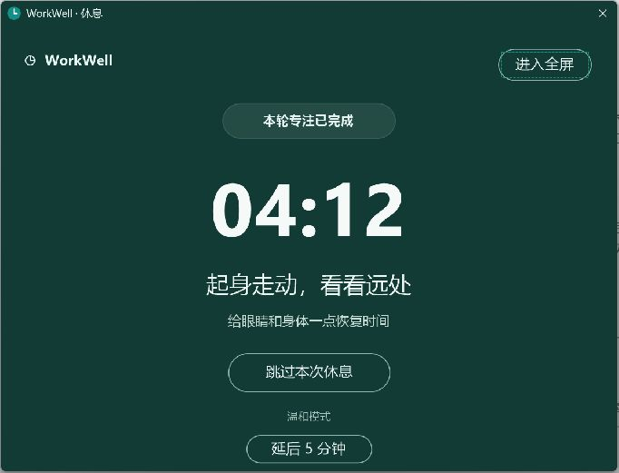

# WorkWell UI 实现与验收

日期：2026-10-24。参考为本次确认的 AI UI 设计图，原图保存在 `design-reference.png`。实际截图来自编译运行后的 Win32 程序，未把设计稿图片铺在窗口上，也未伪造倒计时或统计数据。

## 验收结论与边界

四个界面的布局结构、信息层级、主色、按钮层级与中文文案按设计实现。采用人工逐页截图核对，发现差异后修改并重新编译复查。没有使用“100% 像素还原”或无依据的相似度百分比：参考是一张栅格概念图，没有原始 Figma 尺寸与字体标注；原生窗口边框、字号栅格化也受系统影响。

## 对照清单

| 页面 / 元素 | 实现与比对结果 |
|---|---|
| 专注面板 | 顶部状态胶囊和设置入口；大圆环、居中倒计时；下一次休息说明；轮次圆点；全宽青绿色主按钮；低强调结束操作；底部双列今日统计 |
| 设置 | 大标题；四行数字步进；温和 / 严格模式选项卡；动态规则预览；底部生效说明、取消与保存 |
| 休息 | 深绿色背景；顶部完成胶囊；大号白色倒计时；两级休息提示；描边跳过按钮与模式说明 |
| 完成 | 淡青色圆形勾号；完成标题与说明；开始下一轮主按钮；稍后开始次操作 |
| 颜色 | 背景 #FAFBFC；正文 #14212D；辅助文字 #657181；主色 #148F87；浅青 #EAF6F4；分割线 #E1E6E9；休息背景 #123B35 |
| 字体 | 中文 Microsoft YaHei UI；倒计时 Segoe UI；主要操作和标题采用粗体 |
| 尺寸 | 专注面板客户区 420×730 DIP；设置 446×730 DIP；完成页 480×335 DIP；休息页适应显示器，窗口模式为 680×490 DIP |

## 截图中发现并修复的问题

1. 自绘倒计时增加可访问名称后覆盖圆环左右两侧：缩小原生文字控件边界，重新截图确认圆环完整。
2. 数字步进控件外观陈旧：启用 Common Controls v6，保留真实键盘输入与步进操作。
3. 设置输入缺少可访问名称：为四个输入框增加对应原生标签。
4. 全屏切换到普通窗口后可见样式丢失：保留 WS_VISIBLE，复查全屏往返和倒计时继续。
5. 休息窗口改为深色标题栏，使窗口模式与深绿内容一致。

## 明确的设计差异

- 概念图中的 18:42、3 轮、75 分钟为示例数据。程序显示真实时间与统计，截图不会强行伪造同样的数据。
- 窗口标题栏使用原生 Windows 装饰；主窗口和设置窗口不提供不可用的最大化行为。外观随系统变化。
- 长休息间隔使用数字步进，代替概念图中的下拉框；仍可设置 2–10 轮。
- 休息背景使用统一深绿色，减少概念图轻微纹理带来的干扰。
- 温和模式增加“延后 5 分钟”真实操作；严格模式隐藏跳过、延后及退出全屏。
- 系统水印、鼠标位置和自动化工具的指针高亮属于截图环境，不属于应用 UI。

## 功能验证

自动化测试 `TimerAndConfiguration` 通过，覆盖：延迟消息下的计时精度、暂停 / 恢复、30 秒提醒、五分钟休息单位、设置下一轮生效、延后不重复计数、休息结束等待用户、下一轮应用新设置、严格模式拒绝延后、第四轮长休息、统计重启持久化、配置读写及异常数值校验。

实机已检查：开始与结束、设置保存、无效值提示、温和休息、延后回到面板，以及真实一分钟工作结束后统计更新和进入休息。其余实机结果在本报告的最终检查记录中补充。

## 实际截图

### 专注面板

### 设置

### 休息窗口

[全屏原始截图](actual-break-fullscreen.png)

### 完成

## 未在本机完整覆盖的场景

- 多显示器热插拔、不同 DPI 混用；代码已按显示器创建窗口，但尚无对应设备实测。
- 125%、150%、200% 的完整截图矩阵；实现了 DPI 感知和动态缩放。
- Narrator / NVDA 完整流程；已验证主要按钮、倒计时和设置输入的可访问树名称。
- 严格模式长按 Esc 的真实按住动作；当前自动化接口只提供按键组合，未模拟持续按住。

## 最终实机检查记录

- 在真实界面保存一分钟工作配置，自动结束后进入休息；今日统计记录为 1 轮 / 1 分钟，重启后保留。该记录是本次验收产生的真实测试记录。
- 已恢复正式工作时长为 25 分钟。交付前恢复短休息 5 分钟与温和模式，并停留在准备状态。
- 主面板开始、键盘结束本轮、暂停，以及温和模式延后回到主面板均正常。
- 设置页输入 0 时保持页面打开、标红字段、显示 1–120 分钟范围提示；没有静默改写。
- 严格模式实机截图中没有跳过、延后、退出全屏按钮；Alt+F4 后仍保持休息。
- 严格模式的一分钟休息自然结束后显示完成页；“开始下一轮 · 25 分钟”能开始真实计时。
- 自动化运行日志保存在 `test-results.txt`；Release 构建成功，最后一次构建没有警告。

[严格模式截图](actual-break-strict.png)
- 最终版全屏 → 窗口 → 全屏往返实测通过，倒计时不中断；窗口模式深绿标题栏与内容一致，截图已保存。
- 温和模式跳过后能选择“稍后开始”；再次启动程序只唤回同一主窗口，没有创建第二实例。

## 后续调整：全屏透明度

全屏休息窗口采用 70% 不透明度（alpha=179/255，约透出 30% 桌面），文字和按钮随整个窗口一起混合；窗口模式恢复完全不透明，返回全屏时重新应用。保留鼠标拦截，不启用点击穿透。此调整已通过 Release 编译，上述历史截图保留调整前的验收状态。
